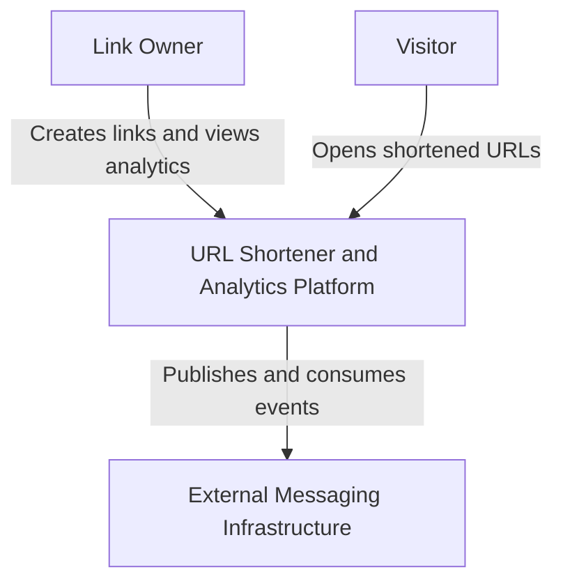
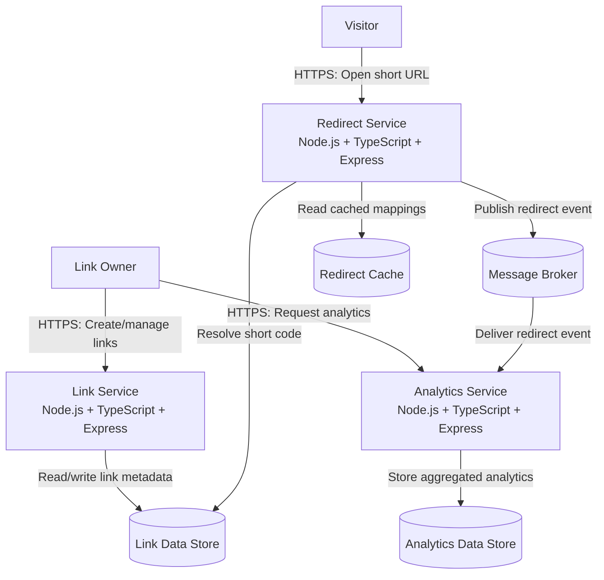

# System Architecture

## 1. Overview

The URL Shortener and Analytics platform is designed as a distributed system composed of three independent microservices.

The platform allows users to create shortened URLs, redirect visitors to their original destinations, and collect analytics about link usage.

The architecture follows separation of concerns and event-driven communication principles.

The diagrams and interactions described below represent the target architecture. Some components are planned and will be implemented in later development stages.

## 2. C4 Level 1 – System Context

### System Description

The URL Shortener platform interacts with two primary external actors:

- **Link Owner:** Creates and manages shortened URLs and views analytics.
- **Visitor:** Opens shortened URLs and gets redirected to the original destination.

### Context Diagram

## 3. C4 Level 2 – Container Diagram

The platform consists of three backend services.

### Container Diagram

## 4. Microservice Responsibilities

### 4.1 Link Service

**Primary responsibility:** URL creation and management.

Responsibilities:
- Accept original URLs from users.
- Validate submitted URLs.
- Generate unique short codes.
- Store and manage link metadata.
- Provide link management endpoints.

**Data ownership:** Link metadata, original URLs, short codes, creation dates, expiration dates, and link status.

### 4.2 Redirect Service

**Primary responsibility:** Resolve shortened URLs and redirect visitors.

Responsibilities:
- Receive requests containing short codes.
- Resolve short codes into original URLs.
- Use caching to improve lookup performance.
- Return HTTP redirects.
- Publish redirect events for analytics.

**Data ownership:** No authoritative ownership of link metadata. It reads link mappings from the Link Service's data store or an approved read interface and may maintain temporary cached copies.

### 4.3 Analytics Service

**Primary responsibility:** Collect and process link usage events.

Responsibilities:
- Consume redirect events.
- Process click information.
- Calculate usage statistics.
- Store analytics data.
- Provide analytics endpoints.

**Data ownership:** Redirect events, click records, aggregated statistics, and analytics metadata.

## 5. Data Ownership

Each service has a clearly defined responsibility for its data.

| Data | Owner | Other service access |
|---|---|---|
| Original URLs | Link Service | Redirect Service reads through an approved interface |
| Short codes | Link Service | Redirect Service resolves them |
| Link metadata | Link Service | Other services access only required information |
| Redirect events | Analytics Service | Redirect Service publishes events |
| Click statistics | Analytics Service | Link Owner reads through Analytics Service |
| Cached mappings | Redirect Service | Temporary, non-authoritative data |

Services must not directly modify another service's owned data.

## 6. Service Communication

The target architecture uses two communication patterns.

### Synchronous Communication

HTTP will be used when an immediate response is required.

Example:
- A user requests link creation.
- The Link Service validates and stores the link.
- The service returns the generated short URL.

### Asynchronous Communication

A message broker will be used for redirect analytics events.

Example:
1. A visitor opens a shortened URL.
2. The Redirect Service resolves the destination.
3. The visitor receives an HTTP redirect.
4. The Redirect Service publishes a redirect event.
5. The Analytics Service consumes and processes the event.
6. Analytics information is stored for later queries.

The messaging technology and exact event contract will be documented in subsequent architecture decisions.

## 7. Reliability and Scalability

The architecture is designed to support:

- Independent deployment and scaling of services.
- Caching for frequently accessed URL mappings.
- Asynchronous analytics processing.
- Timeouts and retries for transient failures.
- Idempotent event processing.
- Health checks and observability.
- Container orchestration through Kubernetes.

These capabilities will be implemented and validated progressively.

## 8. Current Implementation Status

At the current development stage:

- All three Express services have been created.
- Each service exposes a `/health` endpoint.
- Each service runs independently on a separate local port.
- TypeScript type checking completes successfully.

The following components are architectural targets and are not yet implemented:

- URL creation and management.
- Actual redirect resolution.
- Database integration.
- Message broker integration.
- Redirect caching.
- Analytics event processing.
- Kubernetes deployment.

This distinction ensures that the architecture documentation does not claim functionality that has not yet been implemented.